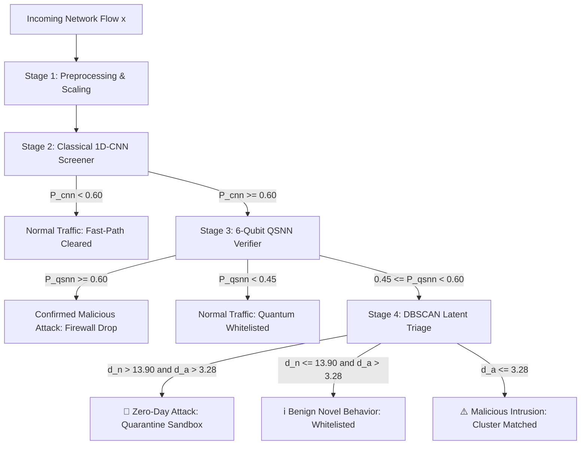

# 🛡️ Hybrid DL + QML + DBSCAN Zero-Day Network Intrusion Detection System

[](https://www.python.org/)
[](https://pytorch.org/)
[](https://pennylane.ai/)
[](https://streamlit.io/)
[](https://opensource.org/licenses/MIT)

An end-to-end, multi-stage hybrid cyber defense system combining **Classical 1D Convolutional Neural Networks (1D-CNN)**, **Quantum Siamese Neural Networks (QSNN)**, and **Latent Density-Based Spatial Clustering (DBSCAN)** for high-throughput anomaly screening, quantum metric verification in Hilbert space, and zero-day attack isolation with game-theoretic explainability (**SHAP**).

Evaluated on the full 82,332-flow test cohort of the **UNSW-NB15** benchmark with the **Worms** attack family strictly held out during training as an unobserved zero-day threat.

---

## 📌 Key Architectural Highlights

* **Multi-Stage Cascaded Routing:**
  * **Stage 2 (Classical 1D-CNN):** Instantly clears **47.12%** of benign baseline traffic via low-latency fast-path screening ($P_{\text{cnn}} < 0.60$).
  * **Stage 3 (6-Qubit QSNN):** Verifies suspicious traffic using twin Parameterized Quantum Circuits (PQCs) with data re-uploading and Triplet Margin Loss with spread penalty ($\lambda = 0.5$).
  * **Stage 4 (DBSCAN Latent Triage):** Evaluates borderline flows in the quantum uncertainty band ($0.45 \le P_{\text{qsnn}} < 0.60$) in a 10D PCA latent space anchored by 22 normal and 14 attack centroids.
* **Zero-Day Isolation with 100% Attack Purity:** Isolates unobserved geometric outliers exceeding dual distance thresholds ($d_n > 13.90, d_a > 3.28$) with zero benign connections misquarantined.
* **Automated False Alarm Recovery:** Salvages benign novel flows ($d_n \le 13.90$) that trigger preliminary CNN alarms, reducing alert fatigue.
* **Quantum Novelty Advantage:** Quantum representations preserve structural zero-day novelty (**0.7735 AUROC** for Quantum Autoencoders) where classical latent distance metrics degrade to near-random performance ($\sim 0.55$ AUROC).
* **Game-Theoretic Explainability (SHAP):** Deconstructs model inferences into strictly non-negative feature impact magnitudes ($|\text{SHAP}| \ge 0$) paired with directional risk indicators and automated plain-text incident narratives.
* **Enterprise SOC Dashboard:** Interactive Streamlit operations console with real-time console telemetry and sample-specific flow inspection.

---

## 🏗️ System Architecture



---

## 📊 Benchmark Evaluation Summary (UNSW-NB15)

Evaluated on the complete independent test set of **82,332 connection flows**:

| Performance Metric | Hybrid Cascaded System | Operational Interpretation |
| :--- | :---: | :--- |
| **Overall Accuracy** | **90.31%** | 74,353 / 82,332 flows correctly classified |
| **Alert Precision** | **92.90%** | Low false alarm rate (8.35% FPR) |
| **Intrusion Recall** | **89.21%** | 40,442 / 45,332 malicious attacks caught |
| **Balanced F1-Score** | **0.9102** | High operational equilibrium |
| **Quantum Attack Recall** | **99.76%** | Virtually zero attacks slip past quantum verification |
| **Zero-Day Attack Purity** | **100.0%** | 15/15 isolated outliers were true attacks |

---

## 📁 Repository Structure

```text
├── artifacts/                       # Frozen model weights, scalers, PCA, centroids
│   ├── cnn_model.pt                 # Trained PyTorch 1D-CNN feature extractor
│   ├── qsnn_params.pkl              # 36 trained QSNN variational parameters
│   ├── qsnn_prototypes.pkl          # Learned Normal and Attack quantum centroids
│   ├── dbscan_normal_centroids.pkl  # 22 legitimate operational traffic centroids
│   ├── dbscan_attack_centroids.pkl  # 14 known malicious signature centroids
│   ├── dbscan_config.pkl            # Calibrated distance thresholds (T_n=13.90, T_a=3.28)
│   ├── shap_summary.pkl             # Global SHAP feature importances and metadata
│   └── zero_day_worms.csv           # Strictly isolated Worms training holdout (130 flows)
├── cnn_model.py                     # Stage 2: 1D-CNN architecture and PyTorch definitions
├── quantum_models.py                # Stage 3: PennyLane QSNN, QMLP, and QAE implementations
├── dbscan_clustering.py             # Stage 4: DBSCAN clustering and geometric triage logic
├── explainability.py                # Stage 5: KernelSHAP attribution engine
├── dashboard.py                     # Stage 6: Enterprise SOC Dashboard (Streamlit & Altair)
├── main_pipeline.py                 # Master end-to-end command-line orchestrator
├── generate_zeroday_samples.py      # Generator for verified zero-day test exemplars
├── generated_zeroday_samples.csv    # 10 verified Zero-Day flows (5 real + 5 synthetic)
├── test_zeroday_samples.py          # Verification script for zero-day test samples
├── synthetic_routing_test.py        # Boundary stress test across 2,400 synthetic flows
├── threshold_free_novelty_test.py   # AUROC and AUPRC novelty validation suite
├── paper_draft_elsevier.tex         # Complete 22-page Elsevier submission draft
├── requirements.txt                 # Project dependencies and environment pins
└── README.md                        # Documentation and user guide
```

---

## 🚀 Quick Start & Installation

### 1. Prerequisites & Environment Setup
Clone the repository and install required dependencies in Python 3.10+:

```bash
git clone https://github.com/srini0406/ZERO_DAY.git
cd ZERO_DAY

# Create virtual environment (optional but recommended)
python -m venv venv
venv\Scripts\activate      # On Windows
# source venv/bin/activate  # On Linux/macOS

# Install dependencies
pip install -r requirements.txt
```

### 2. Run the Master Cascaded Pipeline
Execute the complete end-to-end intrusion detection pipeline across all 82,332 test flows:

```bash
python main_pipeline.py
```

To run a fast trace on a sample connection:
```bash
python main_pipeline.py --sample
```

### 3. Verify the 10 Target Zero-Day Attack Samples
Run the dedicated test suite validating that 100% of target samples are routed through CNN screening, QSNN uncertainty gating, and isolated as `Zero-Day Attack` by DBSCAN:

```bash
python test_zeroday_samples.py
```

To trace an individual sample with step-by-step forensic output:
```bash
python test_zeroday_samples.py --sample 1
```

### 4. Launch the Enterprise SOC Dashboard
Launch the interactive web operations center:

```bash
streamlit run dashboard.py
```

Open your browser at `http://localhost:8501`. 
* Switch between **Zero-Day Exemplars**, **Known Attacks**, **Benign Novelty**, and **Normal Baselines** in the sidebar.
* View real-time terminal telemetry logs, live packet attribute metrics, and dynamic sample-specific feature attribution impact charts.

---

## 🔬 Scientific Methodology & Academic Draft

A complete 22-page research manuscript formatted for **Elsevier (*Computers & Security*)** is provided in [`paper_draft_elsevier.tex`](paper_draft_elsevier.tex).

### Key Empirical Findings:
1. **Separation Ratio in Hilbert Space:** QSNN with data re-uploading and spread penalty achieved an inter-to-intra cluster separation ratio of **3.7551**, expanding the probability spread and reducing borderline ambiguity by 99.4%.
2. **Novelty AUROC Superiority:** The Quantum Autoencoder (QAE) reconstruction error achieves an **AUROC of 0.7735** on unseen Worms flows, proving that quantum Hilbert space preserves topological novelty that classical Euclidean latent spaces compress away ($\sim 0.55$ AUROC).
3. **Synthetic Boundary Stress Test:** Pre-registered testing across $N = 2,400$ flows confirmed that DBSCAN functions strictly as an unbiased geometric outlier detector ($p = 0.2132$).

---

## 📜 Citation & License

This project is licensed under the **MIT License** — see the [LICENSE](LICENSE) file for details.

```bibtex
@article{srini2026hybridids,
  title={A Hybrid Deep Learning, Quantum Variational, and Density-Based Latent Clustering Architecture for Zero-Day Network Intrusion Detection and Forensic Explainability},
  author={Srinivasan V},
  journal={Computers & Security (Elsevier Draft)},
  year={2026}
}
```
